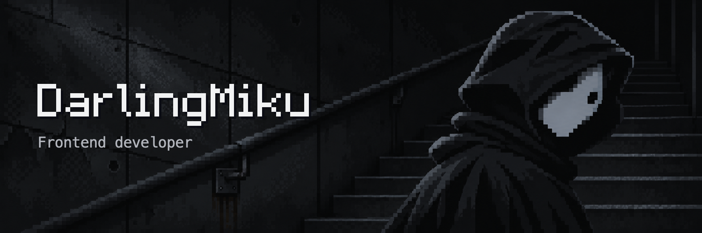
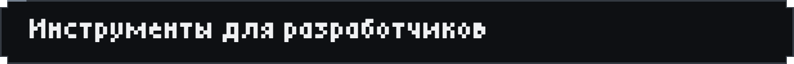
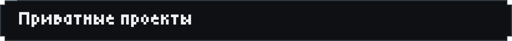
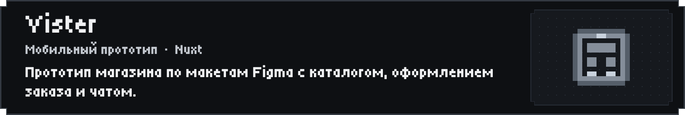
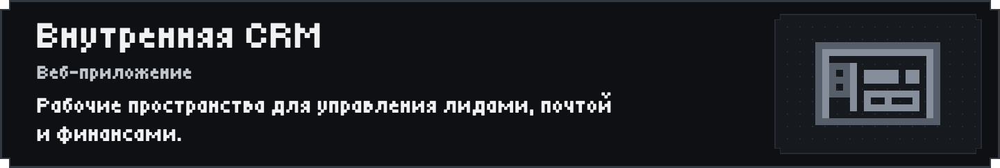
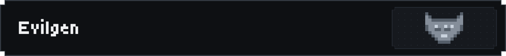
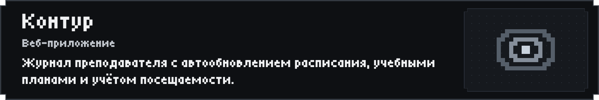
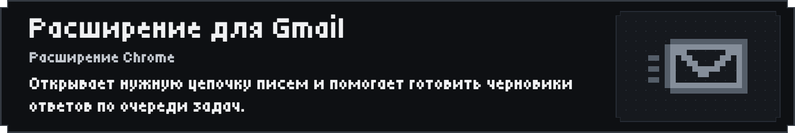

<picture>
  <source media="(max-width: 960px)" srcset="assets/profile/about/pixel-card-mobile.png">
  
</picture>

<h2 id="инструменты-для-разработчиков">
<picture>
  <source media="(max-width: 960px)" srcset="assets/profile/projects/heading-mobile.png">
  
</picture>
</h2>

<a href="https://github.com/DarlingMiku/skeleton-capture">
<picture>
  <source media="(max-width: 960px)" srcset="assets/profile/projects/skeleton-capture-mobile.png">
  
</picture>
</a>

<a href="https://github.com/DarlingMiku/pixel-stamp">
<picture>
  <source media="(max-width: 960px)" srcset="assets/profile/projects/pixel-stamp-mobile.png">
  
</picture>
</a>

<a href="https://github.com/DarlingMiku/spring-lab">
<picture>
  <source media="(max-width: 960px)" srcset="assets/profile/projects/spring-lab-mobile.png">
  
</picture>
</a>

<a href="https://github.com/DarlingMiku/network-trace-lab">
<picture>
  <source media="(max-width: 960px)" srcset="assets/profile/projects/network-trace-lab-mobile.png">
  
</picture>
</a>

<a href="https://github.com/DarlingMiku/nuxt-route-diff">
<picture>
  <source media="(max-width: 960px)" srcset="assets/profile/projects/nuxt-route-diff-mobile.png">
  
</picture>
</a>

<a href="https://github.com/DarlingMiku/css-token-inspector">
<picture>
  <source media="(max-width: 960px)" srcset="assets/profile/projects/css-token-inspector-mobile.png">
  
</picture>
</a>

<h2 id="приватные-проекты">
<picture>
  <source media="(max-width: 960px)" srcset="assets/profile/private-projects/heading-mobile.png">
  
</picture>
</h2>

<picture>
  <source media="(max-width: 960px)" srcset="assets/profile/private-projects/vister-mobile.png">
  
</picture>

<picture>
  <source media="(max-width: 960px)" srcset="assets/profile/private-projects/crm-mobile.png">
  
</picture>

<picture>
  <source media="(max-width: 960px)" srcset="assets/profile/private-projects/evilgen-mobile.png">
  
</picture>

<picture>
  <source media="(max-width: 960px)" srcset="assets/profile/private-projects/kontur-mobile.png">
  
</picture>

<picture>
  <source media="(max-width: 960px)" srcset="assets/profile/private-projects/gmail-extension-mobile.png">
  
</picture>

## Контакты

[Telegram](https://t.me/mlkumlku) · [Почта](mailto:stonyaleks@gmail.com)
