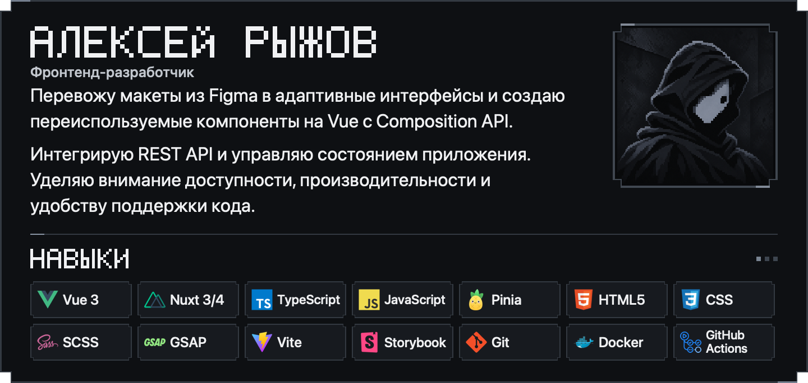

<picture>
  <source media="(max-width: 960px)" srcset="assets/profile/about/pixel-card-mobile.png">
  
</picture>

## Инструменты для разработчиков

Снимает размеры компонентов в Chrome DevTools и экспортирует адаптивные заглушки загрузки на основе замеров.

Рисует и зеркалит пиксельные иконки, показывает их на светлом и тёмном фоне и экспортирует в PNG с прозрачностью.

Помогает настроить пружинную анимацию, сравнить её с кривой ease-out и экспортировать кривую для CSS.

Показывает запросы из HAR-файла на временной шкале, помогает разобрать медленные запросы и экспортировать сводные метрики.

Сравнивает два дерева страниц Nuxt, находит изменения и возможные конфликты маршрутов и экспортирует отчёт для пул-реквеста.

Собирает вычисленные значения CSS-переменных, сравнивает две темы или страницы и копирует различия в Markdown.

## Приватные проекты

- **Внутренняя CRM** — рабочие пространства для управления лидами, почтой и финансами.
- **Прототип мобильного магазина** — перенос макетов из Figma в Nuxt с каталогом, оформлением заказов и чатом.
- **Расширение для работы с Gmail** — открывает нужную цепочку писем и помогает готовить черновики ответов по очереди задач.

## Контакты

[Telegram](https://t.me/mlkumlku) · [Почта](mailto:stonyaleks@gmail.com)
