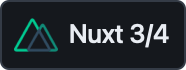
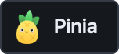
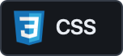
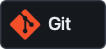
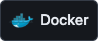
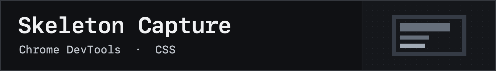
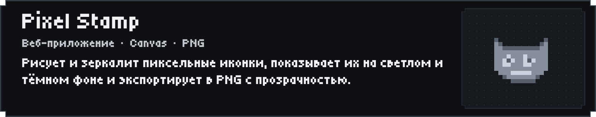
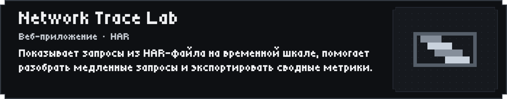
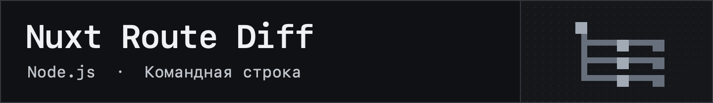

<table width="100%">
  <tr>
    <td valign="top">
      
      <h3>Alexey Ryzhov</h3>
      
I’m a frontend developer. I turn Figma designs into responsive interfaces and build reusable components with Vue’s Composition API.

      
I integrate REST APIs and manage client-side state. I focus on accessibility, performance, and keeping the frontend easy to maintain.

    </td>
  </tr>
</table>

## Skills

  
  
  
  
  
  
  
  
  
  
  
  
  
  

## Developer tools

Capture component geometry in Chrome DevTools and export responsive loading skeletons from measured widths.

Draw and mirror pixel icons, preview them on light and dark backgrounds, and export transparent PNGs.

Tune a spring, compare its motion with cubic ease-out, and export the easing curve as CSS.

Inspect HAR captures in a request waterfall, drill into slow requests, and export aggregate performance metrics.

Compare two Nuxt pages trees, spot route changes and possible collisions, and export a report for a pull request.

Capture computed CSS variables, compare two themes or pages, and copy the visible differences as Markdown.

## Private work

- **Internal CRM** — Workspaces for managing leads, email, and finance.
- **Mobile commerce prototype** — A Figma-to-Nuxt prototype with catalog, checkout, and chat flows.
- **Gmail workflow extension** — A browser helper for opening the relevant thread and preparing draft replies from a task queue.

## Contact

[Telegram](https://t.me/mlkumlku) · [Email](mailto:stonyaleks@gmail.com)
